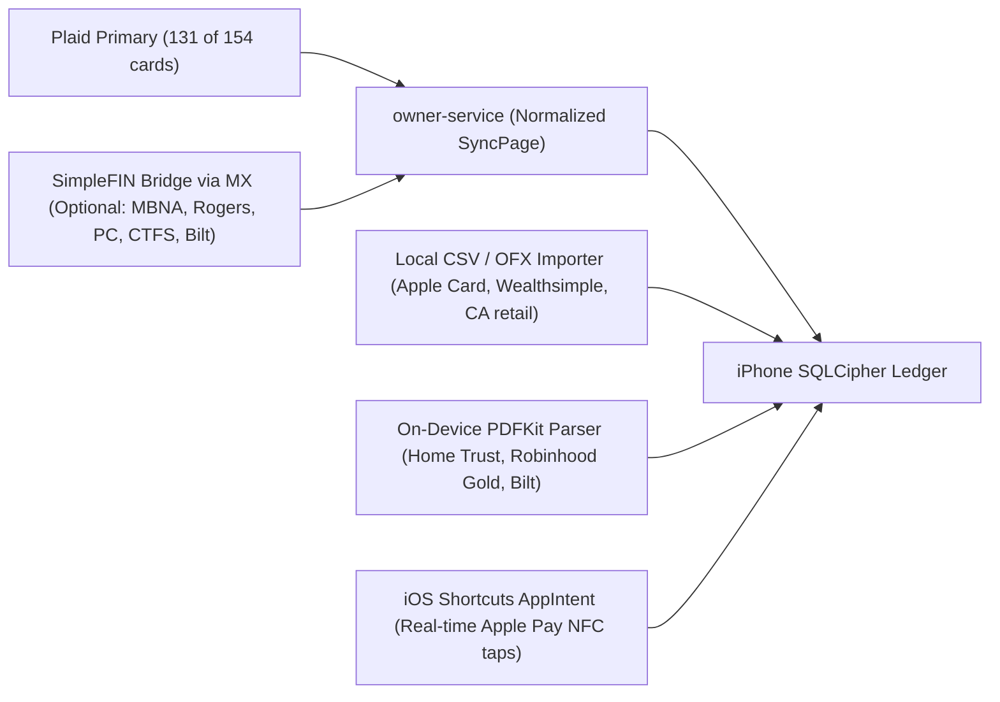

# Plaid Coverage & Alternatives Report — Card Ledger Catalog (`v2026.11.6`)

Date: 2026-11-19 · Catalog: [`CardLedger/CardLedger/Resources/catalog.json`](CardLedger/CardLedger/Resources/catalog.json) (`v2026.11.6`)

> **Scope & Verification Basis:** Audited all **156 products** (**154 named cards** across **27 issuer/market pairs** plus 2 generic `Other` fallbacks) against current (late 2026) Plaid U.S./Canada institution support, open-banking/OAuth coverage, real-world sync behavior, and alternative data-ingestion paths suited to Card Ledger's **single-owner, private iOS + self-hosted `owner-service`** architecture ([`Feasibility-Study.md`](Feasibility-Study.md)).

---

## 1. Executive Summary

| Support Tier | U.S. Cards | Canadian Cards | Total Named Cards | Share of Catalog |
|---|---:|---:|---:|---:|
| **Not supported by Plaid** (hard gap) | 1 | 4 | **5** | 3.2% |
| **Partial / unreliable / degraded on Plaid** | 4 | 14 | **18** | 11.7% |
| **Supported by Plaid (OAuth — U.S.)** | 74 | 0 | **74** | 48.1% |
| **Supported by Plaid (credential/session — Canada)** | 0 | 57 | **57** | 37.0% |
| **Total Named Catalog Cards** *(excl. 2 generic `Other`)* | **79** | **75** | **154** | **100%** |

### Key Takeaways
1. **U.S. coverage is strong (74/79 named cards use official Plaid OAuth), with 3 modern fintech exceptions:**
   - **Apple Card** (1 card) is not supported via standard Plaid credentials, and Apple's native **FinanceKit** API is **blocked for private/individual developer apps** (requires an Organization Apple Developer account + public App Store distribution).
   - **Bilt 2.0 — Blue, Obsidian, Palladium** (3 cards) migrated off Wells Fargo to **Cardless / Column N.A.**; old Wells Fargo Plaid links no longer apply and Bilt 2.0 Plaid support has had integration gaps and account-split quirks.
   - **Robinhood Gold Card** (1 card) links at the Robinhood brokerage level, but the separate credit card account is frequently omitted or delayed in Plaid feeds and lacks native web CSV export.
2. **Canada has the bulk of the gaps (18/75 named cards unsupported or chronically degraded):**
   - **Not supported:** **Home Trust Preferred Visa** (1) and **MBNA Canada** (3).
   - **Chronically brittle or degraded:** **Rogers Bank** (4), **PC Financial** (3), **Wealthsimple Visa** (3 — transactions often arrive stripped to generic `"PREPAID CARD"` descriptors, breaking benefit matching), **Canadian Tire Bank / Triangle** (2), and **Capital One Canada** (2).
   - Even the **57 supported Canadian cards** (Big 5 + Amex CA + Tangerine + Simplii + National Bank) currently rely on credential/session flows rather than universal OAuth, producing periodic MFA re-auth prompts (especially **Amex Canada** and **Scotiabank**). Canada's **Consumer-Driven Banking Act (Bill C-15)** received Royal Assent in March 2026 (draft regulations June 2026) and will ban screen scraping in favor of regulated OAuth APIs as rollout progresses.
3. **Best practical alternative stack for Card Ledger's single-owner model:**
   - **Zero-cloud / preserves Design §6 privacy boundary:** Implement the already-stubbed **CSV/OFX importer** (`CardsView.swift`), add an **on-device `PDFKit` statement parser** (specifically for Home Trust, Robinhood Gold Card, and Bilt 2.0), and expose an **iOS Shortcuts `AppIntent`** triggered by Apple Wallet NFC taps for real-time capture.
   - **Automated multi-bank fallback (if willing to add one low-cost aggregator alongside Plaid):** Add a **SimpleFIN Bridge** adapter (USD 1.50/mo or USD 15/yr, backed by **MX**) in `owner-service` — the only affordable single-owner way to reach MX coverage (notably unlocking **MBNA Canada** and offering a fallback for Rogers/PC/CTFS/Bilt). Enterprise aggregators (**Flinks** at USD 500+/mo, direct **MX**, **Finicity**) are commercially priced out for a single user.

---

## 2. Unsupported & Degraded Cards — Deep Dive

### 2.1 Not Supported by Plaid (5 Cards, 3 Issuers)

| Market | Issuer | Cards in Catalog | Why Plaid Fails | Native Statement Export | Best Practical Alternative for Card Ledger |
|---|---|---|---|---|---|
| **USD** | **Apple** | `apple-card` (Apple Card) | Apple / Goldman Sachs does not allow cloud credential logins via Plaid. Plaid's FinanceKit bridge only works inside FinanceKit-approved App Store apps. | **Yes — built into iOS Wallet** (CSV, OFX, QFX, QBO monthly exports) | **1. iOS Wallet CSV/OFX import** (cleanest full-history path) **2. iOS Shortcuts Wallet Transaction trigger** (real-time Apple Pay tap logging) *(FinanceKit is unavailable to individual/private builds)* |
| **CAD** | **Home Trust** | `home-trust-preferred` (Preferred Visa) | Legacy eZCard web portal with no Open Banking API and no Plaid institution connector. | **PDF only** (no native CSV/OFX export) | **1. On-device `PDFKit` statement parser** (local PDF → ledger) **2. iOS Shortcuts Apple Pay trigger** + manual reconciliation |
| **CAD** | **MBNA** | `mbna-rewards-we`, `mbna-true-line`, `mbna-rewards-plat` (3 cards) | No stable/native Plaid Canada Transactions connector; routinely fails with unsupported or persistent auth errors. | **Yes — CSV** (and QFX/QIF variants) via MBNA Online Banking | **1. SimpleFIN Bridge (MX)** — MBNA's TD-backed portal generally syncs better via MX/SimpleFIN than Plaid **2. CSV/OFX import** via MBNA Online Banking |

---

### 2.2 Partial, Unreliable, or Degraded on Plaid (18 Cards, 7 Issuers)

| Market | Issuer | Cards in Catalog | Plaid Failure Mode | Native Statement Export | Best Practical Alternative for Card Ledger |
|---|---|---|---|---|---|
| **USD** | **Bilt (2.0)** | `bilt-blue`, `bilt-obsidian`, `bilt-palladium` (3 cards) | Migrated from Wells Fargo to **Cardless / Column N.A.** Old Wells Fargo Plaid connections broke; Bilt 2.0 / Cardless Plaid links have experienced missing institution listings, auth failures, and split accounts (Bilt Pay vs Credit Card). | **Limited** — statement-period downloads via Cardless portal (no flexible multi-month web CSV exporter) | **1. Try Plaid (`Bilt Rewards` / `Cardless`)** and map only the Credit Card sub-account **2. SimpleFIN Bridge (MX)** fallback **3. Statement CSV/PDF import** + Apple Pay Shortcuts |
| **USD** | **Robinhood** | `robinhood-gold-card` (Robinhood Gold Card) | Plaid connects to Robinhood brokerage/cash accounts, but the separate **Gold Card** credit account is frequently omitted, delayed, or missing pending transactions. | **PDF statements only** (no native web CSV export) | **1. On-device `PDFKit` statement parser** for monthly PDFs **2. iOS Shortcuts Apple Pay trigger** for daily spend tracking |
| **CAD** | **Rogers Bank** | `rogers-red-we`, `rogers-red-mc`, `rogers-red-world`, `rogers-red-legend` (4 cards) | No Open Banking API; brittle screen scraping frequently breaks for weeks/months after MFA or portal updates. | **Yes — CSV & OFX** via Rogers Bank web portal | **1. CSV / OFX import** (most reliable) **2. SimpleFIN Bridge (MX)** (listable, though still subject to intermittent MFA drops) |
| **CAD** | **PC Financial** | `pc-world-elite`, `pc-mastercard`, `pc-insiders-we` (3 cards) | Strict MFA and bot protection cause frequent Plaid drops after a few days or block initial authentication. | **Yes — CSV** (~1 year history via PC Financial web portal; no native OFX) | **1. CSV import** (cleanest & zero MFA churn) **2. SimpleFIN Bridge (MX)** (supported, moderate volatility) |
| **CAD** | **Wealthsimple** | `wealthsimple-vi-2`, `wealthsimple-vip`, `wealthsimple-vi-1` (3 cards) | Institution connects via Plaid, but Visa credit card transactions frequently arrive with **stripped/generic merchant text** (e.g., `"PREPAID CARD"`), breaking merchant matching and category rewards. | **Yes — CSV** via desktop web (`my.wealthsimple.com`; not available in mobile app) | **1. Desktop web CSV import** (preserves real merchant descriptions) **2. Apple Pay Shortcuts** for tap-to-pay enrichment |
| **CAD** | **Canadian Tire Bank** | `triangle-world-elite`, `triangle-mc` (2 cards) | Spotty Plaid directory coverage; CAPTCHA and security walls frequently break background scraping. | **Yes — CSV** by statement period via CTFS online portal | **1. CSV import** (statement period download) **2. SimpleFIN Bridge (MX)** (mixed reliability; manual re-auth needed) |
| **CAD** | **Capital One Canada** | `capone-ca-platinum`, `capone-ca-guaranteed` (2 cards) | Distinct from Capital One U.S. OAuth; Canadian branch uses legacy credential flows with high error rates, MFA loops, and delayed posting. | **Yes — CSV / QFX** via Capital One Canada web portal | **1. CSV import** (reliable) **2. SimpleFIN Bridge (MX)** fallback |

> **Impact on Card Ledger's Benefit Engine:** Even when **Wealthsimple Visa** or **Robinhood Gold Card** partially connects through Plaid, stripped merchant descriptions (`"PREPAID CARD"`) or missing pending/posted linkage degrade `BenefitEngine` matching, `RewardsEngine` category detection, and `PlaidMapping.kind` credit classification. For those cards, clean CSV/PDF import produces better ledger accuracy than a broken Plaid feed.

---

## 3. Complete Catalog Support Matrix (All 27 Issuer/Market Pairs)

### 3.1 United States (`USD` — 79 Named Cards + 1 Generic)

| Issuer | Cards | Plaid Status | Auth Mechanism | Known Caveats & Notes |
|---|---:|---|---|---|
| **Chase** | 24 *(4 biz)* | **Supported** | OAuth (app-to-app) | Very reliable. Business cards (`Ink`, `Sapphire Reserve for Business`) may require separate business-portal login or linked profile permissions. |
| **American Express** | 19 *(5 biz)* | **Supported** | OAuth | Reliable once `PLAID_REDIRECT_URI` Universal Link is configured for iOS. Statement credit descriptors can occasionally be truncated (handled by Card Ledger's review queue). |
| **Citi** | 9 | **Supported** | OAuth | Reliable across Citi ThankYou, Costco Anywhere Visa, and AAdvantage cards. |
| **Capital One** | 7 *(2 biz)* | **Supported** | OAuth | Reliable. Accounts with a past-due balance cannot be linked; business cards (`Venture X Business`, `Spark Cash Plus`) occasionally require explicit account selection / periodic re-auth. |
| **Bank of America** | 6 | **Supported** | OAuth | Reliable across Cash/Travel cards and Atmos Rewards (Alaska/Hawaiian) cards. |
| **U.S. Bank** | 4 | **Supported** | OAuth | Reliable across Altitude, Cash+, and Smartly cards. |
| **Wells Fargo** | 3 | **Supported** | OAuth | Reliable for Active Cash, Autograph, and Autograph Journey. *(No longer issues Bilt 2.0 cards.)* |
| **Discover** | 2 | **Supported** | Direct / Tokenized | Generally works, with occasional intermittent disruptions tied to MFA settings and Capital One/Discover backend transitions. |
| **Bilt (Cardless)** | 3 | **Partial / Unstable** | Cardless / Column N.A. | Transitioned off Wells Fargo in 2026; search `Bilt` or `Cardless`, select only the credit card sub-account, and keep CSV/PDF fallback ready. |
| **Robinhood** | 1 | **Partial / Spotty** | Direct / Plaid | Brokerage syncs well, but the Gold Card credit account is often missing or delayed; no native web CSV export (PDF only). |
| **Apple** | 1 | **Not Supported** | N/A *(FinanceKit gated)* | Use Wallet CSV/OFX export + optional Apple Pay Shortcuts automation. |
| *Other (`custom-us`)* | *1* | *Depends on bank* | *Varies* | Generic 1% fallback product. |

---

### 3.2 Canada (`CAD` — 75 Named Cards + 1 Generic)

> **Canada-wide Open Banking status (2026):** Unlike the U.S., Canadian banks do not yet offer universal OAuth for Plaid. Canada's **Consumer-Driven Banking Act (Bill C-15)** received Royal Assent on March 26, 2026, with draft regulations published June 27, 2026 under **Bank of Canada** supervision. Screen scraping will be phased out in favor of regulated OAuth read APIs as accreditation rolls out—until then, expect periodic MFA re-authentication on Canadian Items.

| Issuer | Cards | Plaid Status | Auth Mechanism | Known Caveats & Notes |
|---|---:|---|---|---|
| **RBC** | 9 | **Supported** | Credential / Session | Generally reliable across Avion, ION, WestJet, and BA Visa cards. |
| **TD Canada Trust** | 9 *(1 biz)* | **Supported** | Credential / Session | Generally reliable. `td-aeroplan-business` may require separate business EasyWeb credentials. |
| **CIBC** | 9 | **Supported** | Credential / Session | Generally reliable across Aventura, Aeroplan, Dividend, and Costco Mastercard. |
| **BMO** | 7 | **Supported** | Credential / Session | Generally reliable across eclipse, CashBack, Ascend, Blue Rewards, and VIPorter cards. |
| **Scotiabank** | 7 | **Supported (MFA friction)** | Credential / Session | Supported across Gold Amex, Passport, Momentum, and Scene+, but frequent 2FA prompts can trigger `ITEM_LOGIN_REQUIRED`. |
| **American Express CA** | 11 *(1 biz)* | **Supported (MFA friction)** | Credential / Session | Supported across Cobalt, Platinum, Gold, Aeroplan, Marriott, and Hilton cards, but strict MFA often requires daily or multi-day re-authentication. |
| **Tangerine** | 3 | **Supported (MFA friction)** | Credential / Session | Supported; typically requires weekly 2-step verification re-auth. |
| **Simplii Financial** | 1 | **Supported** | Credential / Session | Supported; sign in with Simplii card number (not CIBC credentials). |
| **National Bank** | 1 | **Supported** | Credential / Session | Supported. *(Parent company of Flinks.)* |
| **Rogers Bank** | 4 | **Unreliable** | Brittle Scraping | Frequently broken for extended periods; use **CSV/OFX** or **SimpleFIN (MX)**. |
| **PC Financial** | 3 | **Unreliable** | Brittle Scraping | MFA/anti-bot walls frequently break links; use **CSV** or **SimpleFIN (MX)**. |
| **Wealthsimple** | 3 | **Degraded Data** | Plaid Session | Connects, but Visa card transactions often show generic `"PREPAID CARD"` text; use **web CSV** for clean merchants. |
| **Canadian Tire Bank** | 2 | **Unreliable** | Brittle Scraping | Spotty directory support + CAPTCHA blocks; use **CSV** or **SimpleFIN (MX)**. |
| **Capital One Canada** | 2 | **Unreliable** | Legacy Credential | High error/MFA drop rates; use **CSV/QFX** or **SimpleFIN (MX)**. |
| **MBNA Canada** | 3 | **Not Supported** | N/A | Unsupported / persistent auth errors on Plaid; use **SimpleFIN (MX)** or **CSV/QFX**. |
| **Home Trust** | 1 | **Not Supported** | N/A | Legacy eZCard portal; **PDF statements only** (use on-device PDF parser). |
| *Other (`custom-ca`)* | *1* | *Depends on bank* | *Varies* | Generic 1% fallback product. |

---

## 4. Evaluation of Alternatives for Card Ledger

Card Ledger's design has two defining constraints ([`Feasibility-Study.md`](Feasibility-Study.md)):
1. **Single-owner private release** (no enterprise SaaS revenue to subsidize USD 500+/mo aggregator minimums, and no public App Store organization distribution).
2. **Design §6 privacy boundary** (transactions live exclusively in on-device SQLCipher; minimize third-party processors).

| Alternative | Cost (Single Owner) | U.S. Gaps Solved | Canada Gaps Solved | Fits Design §6? | Viable Today? | Key Tradeoffs |
|---|---:|---|---|---|---|---|
| **1. CSV / OFX / QFX Importer** *(local on iPhone)* | **Free** | Apple Card, Bilt 2.0 *(partial)* | MBNA, Rogers, PC Financial, Triangle, Wealthsimple *(clean merchants!)*, Capital One CA | **Yes (100% local)** | **Yes — highest ROI** | Manual periodic import (monthly/weekly); already stubbed in `CardsView.swift` & `Provenance.csv`. Does not solve PDF-only cards (Home Trust, Robinhood). |
| **2. On-Device `PDFKit` Statement Parser** | **Free** | Robinhood Gold Card, Bilt 2.0 | Home Trust Preferred Visa *(and any bank)* | **Yes (100% local)** | **Yes** | Runs completely offline via Apple `PDFKit`. Requires per-issuer parser templates (only ~3 issuers need it initially: Home Trust, Robinhood, Bilt). |
| **3. iOS Shortcuts + Apple Wallet NFC Trigger** (`AppIntents`) | **Free** | Apple Card, Bilt 2.0, Robinhood *(tap-to-pay)* | All Apple Pay-eligible Canadian cards | **Yes (100% local)** | **Yes (great companion)** | Real-time capture with zero credentials; **limitation:** only fires on physical NFC Apple Pay taps (misses online/recurring charges and statement credits). |
| **4. SimpleFIN Bridge** *(MX-backed read-only bridge)* | **USD 1.50/mo** or **USD 15/yr** *(up to 25 banks)* | Bilt 2.0 *(MX fallback)* | MBNA *(strong)*, Rogers, PC Financial, Triangle, Capital One CA *(moderate)* | **Policy change** *(adds SimpleFIN + MX)* | **Yes — best paid auto-sync** | Clean HTTP Basic Auth JSON API (`GET /accounts`, max 24 req/day, 90-day window); plugs easily into `owner-service` as a second adapter. No MCCs; Canadian MFA drops still occur. |
| **5. Teller.io** | **Free** *(up to 100 live connections)* | Backup for Chase, Capital One, Citi *(not Apple/Bilt/Robinhood)* | **None** *(U.S. only)* | **Policy change** | **Partial (U.S. backup only)** | Good free U.S. alternative if Plaid Production access is denied, but does **not** solve any of the unsupported cards in this catalog. |
| **6. Apple FinanceKit** | Free *(needs Org Dev account: USD 99/yr)* | Apple Card *(official real-time API)* | **None** | **Yes (on-device)** | **No (blocked)** | Apple explicitly **excludes Individual accounts** and requires **public App Store distribution** in the Finance category. Cannot be used for a private sideloaded app. |
| **7. Flinks** | **USD 500+/mo** *(1-yr minimum)* | Moderate | **Best-in-class** (95%+ Canadian Big 5 & credit union coverage) | **Policy change** | **No (cost)** | Commercial B2B contract only; makes sense only if Card Ledger becomes a paid public product. |
| **8. Direct MX / Finicity / Yodlee** | **Enterprise contracts** (USD 5k–50k+/yr) | High (MX/Finicity) | High (MX) | **Policy change** | **No (cost)** | No self-serve individual production tier. Use **SimpleFIN Bridge** if you want MX coverage at consumer pricing. |

---

## 5. Recommended Integration Roadmap

### Concrete Implementation Priority

1. **Phase 1 — Ship the CSV/OFX Importer (closes 15 of the 23 gap/degraded cards with zero external processors):**
   - Wire up the existing `Import CSV statement` stub in [`CardLedger/CardLedger/Views/CardsView.swift`](CardLedger/CardLedger/Views/CardsView.swift) using `.fileImporter` and existing `Provenance.csv`.
   - Support **OFX/QFX** (standardized XML/SGML — immediately covers **Apple Card**, **Rogers Bank**, **MBNA**, **Capital One CA**, and most major banks with one parser) plus issuer CSV column presets for **PC Financial**, **Canadian Tire Triangle**, and **Wealthsimple Visa** (deterministic `source_id` hashes like `csv:<cardID>:<date>:<amount>:<desc>:<seq>` keep re-imports idempotent).
2. **Phase 2 — Add On-Device `PDFKit` Statement Parsing (closes the 3 PDF-only cards):**
   - Parse monthly statement PDFs locally on iPhone for **Home Trust Preferred Visa**, **Robinhood Gold Card**, and **Bilt 2.0**—keeping 100% of sensitive data on-device and preserving Design §6.
3. **Phase 3 — Add Optional `SimpleFINAdapter` in `owner-service` (if automated sync is desired for MBNA / CA retail cards):**
   - Because [`owner-service/src/plaid.ts`](owner-service/src/plaid.ts) already isolates Plaid behind `PlaidAdapter` and streams `NormalizedTransaction`, adding a `SimpleFINAdapter` (USD 15/yr) lets `owner-service` pull **MBNA Canada** and MX-supported fallback banks into the exact same iOS sync protocol without modifying the iOS app's sync engine (map SimpleFIN's 90-day windowed pull into cursor pages and enforce <= 4–6 syncs/day).
4. **Phase 4 — Add an `AppIntents` Shortcut Action (optional quality-of-life for Apple Card / Robinhood / Bilt):**
   - Expose a `"Log Card Transaction"` App Intent so the user can bind Apple Wallet's native **Transaction** automation to record Apple Pay taps immediately as pending entries, then reconcile/deduplicate when the monthly CSV/PDF statement is imported.
5. **Catalog UX Improvement:**
   - Add a lightweight `plaidSupport` metadata field (`oauth`, `credential`, `limited`, `unsupported`) in [`CardLedger/catalog-src/build_catalog.py`](CardLedger/catalog-src/build_catalog.py) so `AddCardView` / `ConnectBankView` can proactively guide the user (e.g., suggesting *"Import from Apple Wallet (CSV/OFX)"* on Apple Card instead of sending them into Plaid Link).
